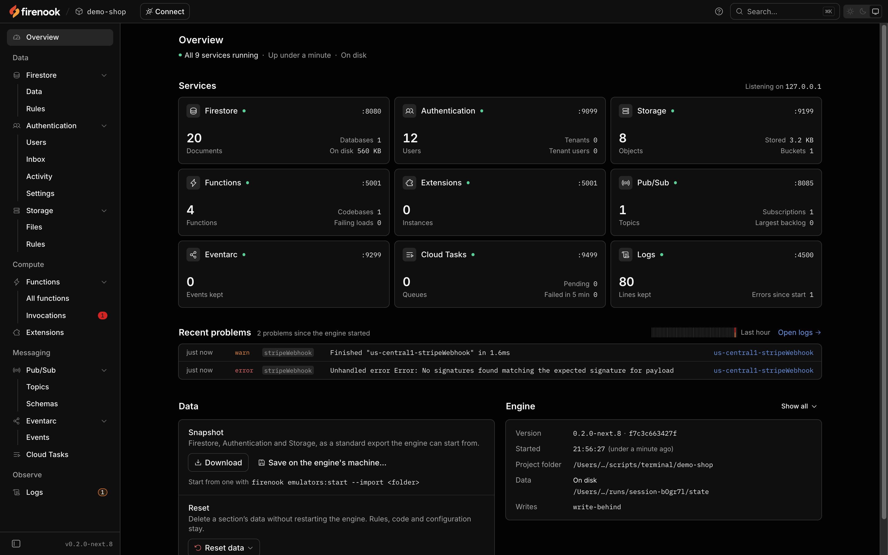

Firenook has its own web console. It shows every emulator the suite runs,
live, and lets you browse and change their data, call your functions, read
the log and test your Security Rules. It replaces Google's Emulator UI, on
the same port.

## Open it

With the default ports, the console is at:

```text
http://127.0.0.1:4000/console
```

In the terminal Firenook draws, press `o` to open it in your browser. The
address is also the first row of the ready summary, so you can click it
there. The port is the Emulator UI's: `emulators.ui.port` in `firebase.json`
changes it, and the root of the port, `http://127.0.0.1:4000/`, sends the
browser to the console.

The console is on by default with `emulators:start`.
`emulators.ui.enabled: false` in `firebase.json` turns it off, together
with the logging listener, as in the official suite. `emulators:exec` leaves it off unless you pass
`--ui` or `firebase.json` sets `emulators.ui.enabled: true`. `--ui` cannot
turn on a console that `firebase.json` turns off.



## Sections

The sidebar groups the sections by what they do: Data, Compute, Messaging
and Observe. A section whose emulator is not running is dimmed. Open it and
it says why, for example that `firebase.json` does not configure the service
or that `--only` left it out, and shows the change that turns it on.

| Section | Pages | What you do there |
| --- | --- | --- |
| Overview | one | See whether every emulator is healthy, what each holds and the newest problems; take a snapshot of the data or reset it; read the engine's version and configuration |
| Firestore | Data, Rules | Browse collections and documents in a grid, edit them, run a query the way your app does, and view the data as a given user would. The Rules page edits the rules and shows every decision with the line and the values behind it, with a playground and saved tests |
| Authentication | Users, Inbox, Activity, Settings | Search and edit users and their custom claims (with the token the claims produce); read every email link and SMS code the emulator would have sent; see every Auth call with its exact error; manage tenants and blocking functions |
| Storage | Files, Rules | Browse every bucket and folder with live counts and sizes, preview images, video, audio, PDFs and text, edit metadata and download tokens, upload files and folders, and move, copy or delete at any scale. The Rules page works as Firestore's does |
| Functions | All functions, Invocations | See every function by codebase with its trigger and health, call HTTP and callable functions as any user, send test events, and read every invocation with its logs and timing, or run it again |
| Extensions | one | See each instance with its source, whether it can start offline, its parameters and where each value comes from, the functions it adds and the events it emits; reconfigure and reload it |
| Pub/Sub | Topics, Schemas | See topics with their subscriptions and the functions they trigger, every message and who received it, publish JSON, text or bytes with attributes, read or purge a backlog, and check Avro schemas as you type |
| Eventarc | Events | See every event on every channel with the triggers it reached or missed, and publish a custom event |
| Cloud Tasks | one | See queues with their settings and counters, waiting and running tasks with their attempts and next retry, and finished ones; enqueue by hand, run a task now, pause, hold and purge |
| Logs | one | Read every emulator's log in one stream with filters and counts, structured payloads, and each function invocation as a group, with links into the section a line is about |

Sections link to each other wherever one names what another shows: an
invocation opens its log lines, a log line opens the section it is about,
and a denied request opens its decision on the Rules page.

The console follows the engine live, so lists, counts and badges change as
your app works. A browser keeps one connection for all its console tabs.
When the connection drops, the top bar says so once; when the engine
restarts, the console says so and loads the data again.

## The Overview's data card

The Overview's data card works on the whole suite:

- **Snapshot** downloads the data as a zip of a standard export, the same
  format `--import` reads, or saves it on the machine the engine runs on.
- **Reset** deletes one section's data, or all of it. Resetting more than
  one section asks for the project id. A Firestore reset runs no
  Functions triggers unless you ask it to.

Each runs as a job: one at a time, with its progress shown in every open
tab, and it carries on if you close the tab that started it.

## Find your way

| Key | Does |
| --- | --- |
| `⌘K` or `Ctrl+K` | Search the console: users, collections, documents, files, functions and actions |
| `?` | Show every keyboard shortcut, including the current page's |
| `[` | Collapse or expand the sidebar |
| `t` | Hide or show the current section's panel |

## Light and dark

The three buttons at the end of the top bar pick light, dark, or the
operating system's setting. The choice is kept per browser. On the system
setting, the console changes when your system does.

## Connect your app

The **Connect** button, in the top bar on every page, opens a dialog with
the code that points an app at this engine, with the ports in use, the
project id and the host your app sees:

| Group | Tabs |
| --- | --- |
| Apps | Web, Flutter, Apple, Android |
| Servers | Admin (Node), Python, Go, Java |
| Configuration | Environment variables, `firebase.json` |
| Agents | Coding agent |

For a `demo-` project the app snippets are complete and run as printed; for
a real project id they keep your app's own configuration and add the lines
that point each SDK at the emulators. The host picker offers the engine's
own address, the address you opened the console at, `10.0.2.2` for the
Android emulator, or one you type, and remembers your choice. The
`firebase.json` tab prints the `emulators` block for the ports this engine
runs on. The Coding agent tab sets up [the MCP server](/docs/tools/mcp) and
shows when an agent last called it.

A link can open the dialog on one tab: `/console?connect=python`.

## Offline

The console is part of the engine binary. Its pages, scripts and fonts come
from the engine itself, so it works with no network connection.

## Old Emulator UI links

Google's Emulator UI is not served since 0.2.0-next.3. Its old addresses,
in bookmarks or in links other tools print, lead to the console's matching
section:

| Old address | Leads to |
| --- | --- |
| `/` | `/console` |
| `/firestore/...` | `/console/firestore` |
| `/firestore/requests` | `/console/firestore/rules` |
| `/auth` | `/console/auth` |
| `/storage/...` | `/console/storage` |
| `/functions` | `/console/functions` |
| `/extensions` | `/console/extensions` |
| `/logs?q=...` | `/console/logs?q=...`, with the query kept |

A path inside a section, such as one document's, opens the section's first
page rather than that document. `/api/config` on the same port still
answers with every emulator's host and port, for the tools that read it.

## Reach it by another name

The console answers only for the names that can only mean this machine:
`localhost`, `127.0.0.1`, `::1`, the `--host` address, and every name under
`localhost`, such as `demo-shop.localhost`. Browsers resolve those names to
your own machine themselves, so no web page can point them elsewhere. That
keeps other sites you visit from reaching the console, which can change and
delete everything the emulators hold.

Reached by any other name, through a reverse proxy, a tunnel, a container's
service name or a cloud host, it refuses the request:

```console
$ curl -H 'Host: emulator.internal:4000' http://127.0.0.1:4000/console
{"error":{"code":"permission-denied","fix":"Start the engine with --allowed-hosts emulator.internal if you meant to.","message":"This console does not answer for host emulator.internal."}}
```

Name the hosts it should answer for with `--allowed-hosts`, comma-separated:

```sh
npx firenook emulators:start --allowed-hosts emulator.internal,dev.example.test
```

Started with `--host 0.0.0.0` (or `::`) and no `--allowed-hosts`, the
console answers any name, and Firenook warns that the emulators are
reachable, without authentication, from any device that can reach your
machine. With `--allowed-hosts` as well, it answers only those names and
the loopback ones.

Local proxies that name apps under `.localhost`, such as
[portless](https://portless.sh), need no flag. Point the name at the UI
port, since that is where the console listens:

```sh
portless alias demo-shop-console 4000
```

Then open `https://demo-shop-console.localhost/console`, with `:1355`
after the name when the proxy runs without sudo. The Connect
dialog's snippets keep `127.0.0.1`, because the name leads to the console,
not to the emulators' own ports.

## Next

[The terminal](/docs/tools/terminal) covers the screen Firenook draws while
it runs, and [Ports](/docs/reference/ports) lists every listener. The
[console page](/console) shows each section in pictures.
